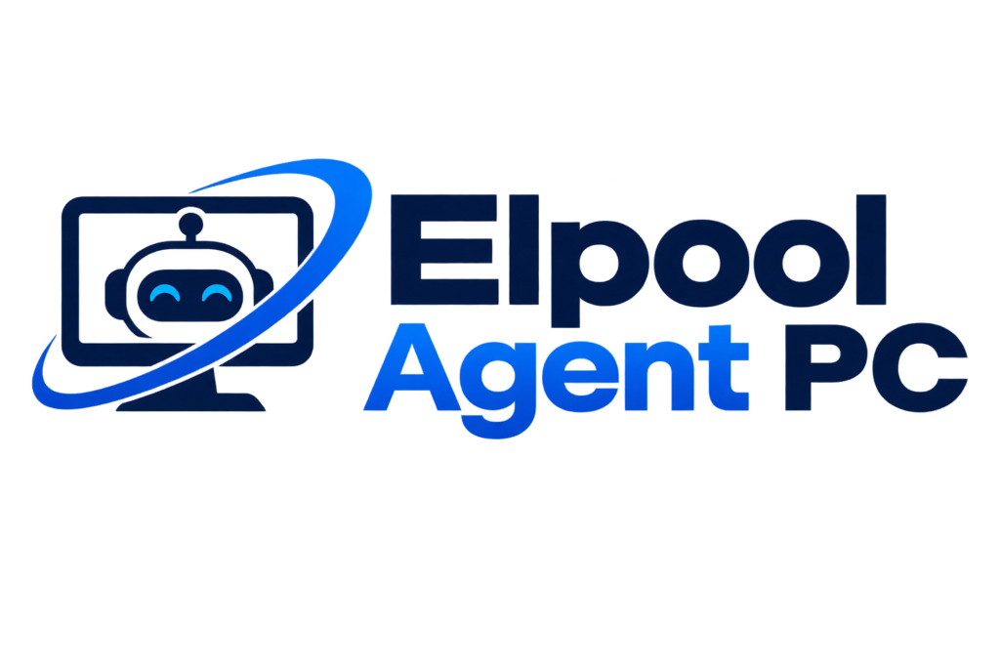

<p align="center">
  
</p>

# Elpool Agent PC (PC Agent AI)

**Versione corrente:** `v1.0.0` *(Semantic Versioning `MAJOR.MINOR.PATCH` — aggiornata a ogni patch, minor o major release; fonte unica in `config/settings.py` → `APP_VERSION`)*

Assistente desktop leggero per **Windows 10/11** nato con lo scopo di **ottimizzare al massimo la Gaming Mode e la telemetria hardware soprattutto su PC con componenti datati o configurazioni sbilanciate** (es. CPU di vecchia generazione / 4-core abbinate a GPU moderne, dischi SATA/HDD con molte ore di utilizzo), affiancato da un chatbot AI basato su **Google Gemini** con esecuzione sicura di strumenti locali.

## Perché nasce questo progetto

Su PC con componenti non più recentissimi ogni singolo ciclo di CPU, picco di I/O su disco o processo in background fa la differenza tra un gameplay fluido e continui micro-stutter. **Elpool Agent PC** è progettato per:
- **Ridurre al minimo il collo di bottiglia CPU** in gioco tramite limite FPS automatico adattato al monitor principale (`Hz - 3`), unparking dei core, riduzione priorità dei processi background e telemetria in modalità *Eco* (`2.5s`, priorità `BELOW_NORMAL`).
- **Spostare il carico sulla GPU quando conviene**, rilevando automaticamente configurazioni CPU-bound con GPU RTX e guidando all'attivazione di **DLDSR**, **HAGS** e **PhysX su GPU dedicata**.
- **Tenere sotto controllo l'usura dell'hardware datato**, integrando temperature e stato di salute S.M.A.R.T. stile *CrystalDiskInfo* (`Good` / `Caution` / `Bad`) per SSD, NVMe e HDD.
- **Mantenere tutto 100% reversibile e sicuro**: ogni modifica della Gaming Mode viene salvata su snapshot persistente (`reports/gaming_state.json`) e ripristinata con un clic su `Balance` (anche dopo il riavvio), senza mai toccare processi di sistema o anti-cheat.

## Funzionalità principali

- **Telemetria live (1s standard / 2.5s Eco in Gaming Mode)**:
  - **CPU**: utilizzo `%`, temperatura `°C`, consumo `W` e ventole di sistema `RPM` *(tramite LibreHardwareMonitor)*.
  - **RAM**: utilizzo, tipo DDR, frequenza attiva `MHz`, modalità canale (`Dual Channel` / `Single Channel`) e dettaglio dei singoli banchi fisici.
  - **Dischi & Salute S.M.A.R.T.**: rilevamento automatico di tutte le unità montate, spazio libero, velocità `R/W MB/s`, **temperatura `°C`** (soglie differenziate SSD vs HDD) e **stato salute stile CrystalDiskInfo** (`Good %`, `Caution`, `Bad`) con avvisi colore per singolo disco.
  - **GPU NVIDIA**: utilizzo `%`, temperatura `°C`, VRAM, consumo `W`, ventole `%` e frequenza Core `MHz` *(tramite `nvidia-smi`)*.
  - **Rete**: interfaccia attiva, link speed, IP locale, traffico `↓ / ↑` live e `Ping` verso `1.1.1.1`.
  - **Riga live Gaming Status**: indicatori immediati in tempo reale per `FPS Cap`, `Servizi BG`, `HAGS`, `DLDSR` e `PhysX`.
  - **Footer di sistema**: versione di Windows e versione del driver grafico installato.
- **Azioni rapide locali**:
  - `Top Process`: mostra i Top 5 processi per CPU e i Top 5 per RAM.
  - `Storage`: report dettagliato stile *CrystalDiskInfo* (modello, interfaccia, salute S.M.A.R.T., temperatura, ore di accensione, GB/TB scritti) e analisi delle principali cache/cartelle pesanti su `C:`.
  - `Gaming Mode` / `Balance`:
    - Attiva il piano *Prestazioni eccellenti* con tuning `powercfg` (USB Suspend OFF, PCIe Power Mgmt OFF, Disk Standby OFF, CPU Core Unpark 100%).
    - Applica ottimizzazioni Windows HKCU senza UAC (Game Mode ON, Game DVR OFF, Notifiche/Trasparenze DWM/Animazioni UI OFF, VRR & Windowed Opt ON).
    - Imposta automaticamente il **Limite FPS NVIDIA (`Max Frame Rate`)** via `NVAPI DRS` (senza UAC) in base al refresh rate del monitor principale (`Hz - 3`), ripristinandolo su `Balance`.
    - Chiude in sicurezza le app background non protette, abbassa a `BELOW_NORMAL` la priorità di app tenute aperte (es. Discord, SteamWebHelper) e di PC Agent AI stesso, pulisce i file temporanei e propone la pausa temporanea dei servizi Windows pesanti (`WSearch`, `SysMain`, `DiagTrack` via UAC).
    - Esegue un **Check-up pre-partita** su HAGS, VRR, PhysX (percorso DCH), DLDSR su sistemi CPU-bound, rete/ping, dischi, temperature e RAM, con feedback esplicito in console su ogni scelta.
  - `Start App`: elenca le applicazioni all'avvio automatico di Windows.
  - `RAM Detail`: report completo su RAM fisica, paging e moduli installati.
  - `Lock LHM`: verifica l'esposizione sulla LAN della porta `8085` di LibreHardwareMonitor e la blocca via Windows Firewall mantenendo attivo `localhost`.
- **Chatbot AI (Google Gemini)**:
  - Rileva automaticamente l'hardware del PC su cui viene eseguito.
  - Può interrogare tutti i sensori (inclusa la salute S.M.A.R.T. dei dischi), analizzare processi/storage, disabilitare app all'avvio e terminare processi bloccati in modo sicuro (chiedendo sempre conferma esplicita e bloccando processi di sistema/protetti).
  - Fallback automatico tra modelli Gemini in caso di sovraccarico dei server (`503`/`429`).

## Requisiti

- **Windows 10 / 11**
- **Python 3.10+** (con `Add Python to PATH` abilitato)
- **Chiave API Gemini** (gratuita su [Google AI Studio](https://aistudio.google.com/apikey)) — *opzionale: senza chiave la telemetria e i pulsanti locali funzionano comunque*
- *(Opzionale)* **[LibreHardwareMonitor](https://github.com/LibreHardwareMonitor/LibreHardwareMonitor)** con Web Server attivo su `http://localhost:8085` per leggere temperatura CPU, Watt CPU e ventole scheda madre
- *(Opzionale)* GPU **NVIDIA** con driver installati per la telemetria GPU (`nvidia-smi`)

## Installazione rapida

1. Scarica o clona questo repository:
   ```bash
   git clone https://github.com/Elpool95/PC_Agent_AI.git
   cd PC_Agent_AI
   ```
2. Fai doppio clic su **`install.bat`**:
   - Crea un ambiente virtuale isolato (`.venv`)
   - Installa le dipendenze da `requirements.txt`
   - Crea il file `config/.env` da `config/.env.example`
   - Crea automaticamente l'icona di avvio **"PC Agent AI"** sul Desktop
3. Apri il file `config/.env` e inserisci la tua API Key:
   ```env
   GEMINI_API_KEY=la_tua_chiave_api
   ```
   *(In alternativa puoi impostare `GEMINI_API_KEY` come variabile d'ambiente di Windows).*
4. Avvia l'app con **`avvia_agent.bat`** (o dal collegamento sul Desktop).

## Personalizzazione

Puoi modificare soglie di allerta, modelli Gemini, app chiudibili in `Gaming Mode` e processi protetti in `config/settings.py`.

## Struttura del progetto

- `config/` — configurazioni, soglie e `pytest.ini` (`settings.py`, `.env.example`)
- `modules/` — moduli applicativi (`agent_win11.py`, `ai_agent.py`, `tools.py`)
- `tests/` — suite di test unitari, sicurezza e usabilità GUI
- `doc/` — documentazione tecnica completa (`architecture.md`, `security.md`, `testing-and-skills.md`, `licenses.md`, `changelog.md`)
- `reports/` — log runtime e report JUnit XML (`junit.xml`)
- `.agents/` — regole (`rules/`) e skill (`skills/`) per coding agent

## Autore & Licenza

- **Autore**: Elpool95
- **Licenza**: [MIT License](LICENSE) — per l'elenco completo delle licenze di terze parti (`psutil` BSD-3-Clause, `google-genai` Apache-2.0, `pytest` MIT, ecc.) vedi [doc/licenses.md](doc/licenses.md).
